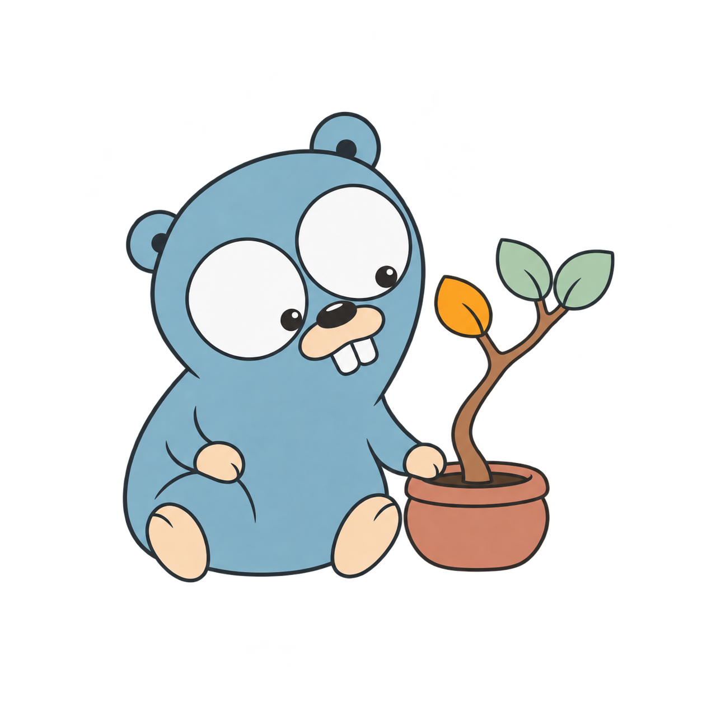

<div align="center">
  
  <h1>adt</h1>
  <p>Generate tagged unions and exhaustive matchers for Go.</p>
  <p>
    <a href="go.mod"></a>
    <a href="https://github.com/k1ngmang/adt/actions/workflows/ci.yml"></a>
    <a href="https://github.com/k1ngmang/adt/releases"></a>
    <a href="LICENSE"></a>
  </p>
</div>

`adtgen` turns an ordinary Go interface declaration into a type with a fixed
set of variants. Each variant can carry its own fields. The generated
`Match` function accepts one handler per variant, so adding a variant and
regenerating makes the compiler report missing handlers.

## Quick start

Install the generator with Go 1.22 or later.

```sh
go install github.com/k1ngmang/adt/cmd/adtgen@latest
```

From a local checkout, use `go install ./cmd/adtgen`.

Make sure Go's binary directory is on your `PATH`. Then add a file such as
`status.go` to your own package.

```go
package order

//go:generate adtgen Status

type statusSpec interface {
    Pending()
    Shipped(trackingID string)
}
```

Run `go generate` in that package. It creates `status_gen.go` beside the
declaration. You can then use the constructors and matcher like any other
functions in the package.

```go
func label(s Status) string {
    return MatchStatus(s,
        func() string { return "Pending" },
        func(trackingID string) string { return "Shipped: " + trackingID },
    )
}

var orderLabel = label(NewStatusShipped("ZX-42"))
```

Commit `status_gen.go` alongside `status.go`. Anyone building the project
uses ordinary `go build` or `go test`. Run `go generate` again when you change
the declaration. See [the arithmetic example](example/expr/expr.go) for a
recursive type.

## How declarations work

- To get `statusSpec` from `Status`, lowercase the first letter and add `Spec`. Each exported method signature declares a variant. Fields must be
  named and non-variadic. A variant can have no fields.
- Handlers follow declaration order. Append new variants to keep the existing
  handler positions stable. Each handler must be a non-nil function.
- By default, the first variant is the zero value, with its fields set to
  their zero values. To make the choice explicit, use
  `//go:generate adtgen -zero Pending Status`.
- The generator accepts `-in` and `-out` to override the filenames. Use an
  explicit import alias if an imported package's name differs from the last
  segment of its path.
- Generated types are concrete and cannot be compared with `==` or used as
  map keys. Variant fields may refer to the type itself or use instantiated
  generic types.

## Development and releases

Run `make` to regenerate and build, or `make test` to regenerate and test.
The bundled example runs the generator directly from source.

[CI](.github/workflows/ci.yml) checks formatting, generation, vet, tests, and
the build on the minimum and stable Go versions. Pushing a version tag such as
`v0.1.0` runs those checks and [publishes a release](.github/workflows/release.yml)
with `adtgen` binaries for Linux, macOS, and Windows on amd64 and arm64, plus
SHA-256 checksums.

The mascot illustration is based on the [Go Gopher by Renee French](https://go.dev/blog/gopher).
